# Generating Urban Massing in Context from Text and Block Graphs

10-x23 Generative AI course project (Daehong Kim, James Fu, Chenyue Shen).

Given a real 512 m tile of New York City with 1–4 adjacent blocks masked out and a short request, we generate 2.5D building maps for the masked blocks that meet per-block targets (coverage, FAR, height, use) and fit the surrounding city. A language model turns the request into a table of targets, and a graph-conditioned discrete diffusion model adapted from Liu et al. (ICCV 2025) generates the map.

This file is the progress log of the baseline (the original Liu model on NYC data): status, steps, problems and open items. It is updated after every step.

## Repository layout

| Folder | Contents |
|---|---|
| `control-3d-scene/` | Model code. **Adapted from [Liu et al., control-3d-scene](https://github.com/yuhengliu02/control-3d-scene)** (commit `9437101`, MIT License, see `control-3d-scene/LICENSE`). The first commit of this repository imports their code unmodified; all later changes to this folder are ours, so `git diff 4b33356 -- control-3d-scene` lists them. |
| `nyc-massing-data/` | NYC data pipeline (Daehong). The built data (`data/`, about 2 GB) is not in the repository; run the pipeline to rebuild it. |
| `latex/` | Not tracked here. The proposal (`main.tex`) and midway executive summary (`midway.tex`) live in the team's Overleaf project; locally `latex/` is a git clone of that project. |
| `progress/` | Figures and logs of each step |

## Current status

**Baseline first results are in (Nov 18, 12:08 ET)**: 55 training epochs, 1 hour of localization post-training, generation and scoring on the first 200 test samples. Main finding: **localization is the weakest part**. With true block centers, cell accuracy is 0.42; with the model's own predicted centers it drops to 0.32, and 35% of the masked area is drawn as street. See Step 5.

| Step | Contents | Status |
|---|---|---|
| 0 | AWS environment, data upload, code setup | ✅ Done |
| 1 | Adapter (NYC data → Liu format) + check figures | ✅ Done |
| 2 | Test run, GPU memory and speed | ✅ Done |
| 3 | Overfit 8 tiles | ✅ Done, passed |
| 4 | Full training (12 h) + localization post-training (1 h) | ✅ Done |
| 5 | Test generation (200 samples × 4) + midway figures | ✅ Scores and figures done; midway draft written |

**Results**: `progress/step5_baseline/` (scores and figures). No training is running on AWS.

---

## Quick reference

### Locations

| Location | Contents |
|---|---|
| Laptop `nyc-massing-data/` | Daehong's data pipeline (not modified) |
| Laptop `control-3d-scene/` | Model code (Liu's code + our changes) |
| AWS `~/genai-final/control-3d-scene/` | Same code, used for training |
| AWS `~/genai-final/data/city/` | NYC data (cls / block / water .npy and parquet files) |
| AWS `~/genai-final/checkpoints/` | Training checkpoints |
| AWS `~/genai-final/logs/` | Training logs (text) |
| AWS `~/genai-final/generated/` | Generated results |

### Training health check

`tools/nyc_watch.py` checks a running training every 30 minutes and appends one line to [progress/watch_log.txt](progress/watch_log.txt). It checks for error messages, NaN, whether the tmux session is alive, whether the log has stopped updating for 15 minutes, loss spikes, gradient spikes, and less than 5 GB of free disk. Any of these raises an alert.

Manual check:
```bash
ssh a4-gpu "source ~/miniconda3/etc/profile.d/conda.sh && conda activate genai-final && cd ~/genai-final/control-3d-scene && python tools/nyc_watch.py ~/genai-final/logs/step4_baseline.log"
```

### Common commands (on the laptop)

`a4-gpu` is an alias in `~/.ssh/config`.

```bash
# connect to AWS
ssh a4-gpu

# watch the running training (detach: Ctrl+B, release, then D; training keeps running)
ssh -t a4-gpu tmux attach -t train

# list tmux sessions
ssh a4-gpu tmux ls

# last 30 lines of a log without entering tmux
ssh a4-gpu tail -n 30 ~/genai-final/logs/<name>.log

# loss curves: keep this connection open, then open http://localhost:6006 in a browser
ssh -L 6006:localhost:6006 a4-gpu "source ~/miniconda3/etc/profile.d/conda.sh && conda activate genai-final && tensorboard --logdir ~/genai-final/checkpoints --port 6006"
```

Code is synced to AWS through this repository (push here, pull on AWS).

Activate the environment on AWS:

```bash
source ~/miniconda3/etc/profile.d/conda.sh && conda activate genai-final
```

---

## Step log

### Step 0: environment, data, code (done Nov 17)

**What was done**
- **Code**: Liu's repository (`yuhengliu02/control-3d-scene`, commit `9437101`) was imported unmodified as the first commit; our changes follow as separate commits.
- **Conda environment `genai-final`** (AWS only): Python 3.10, PyTorch 2.5.1 + CUDA 12.4, torch_geometric 2.8.1, torch_scatter and Liu's other requirements, plus pyarrow (parquet) and matplotlib (figures). Setup script: AWS `~/genai-final/setup_env.sh`.
- **Data**: the 9 files from `data/processed/city/` needed for training (873 MB) were uploaded and all checksums matched.

**Checks**
- PyTorch sees the A10G and GPU computation works.
- Liu's 2D model builds in the new environment with **59.0M parameters** (128×128, 10 classes).

**AWS machine**: g5.xlarge, A10G 23 GB, 4 vCPUs, 15 GB RAM, Ubuntu 26.04.

### Step 1: adapter (done Nov 17)

**What was done** (commit `f73cbd7`)

| File | New / changed | Purpose |
|---|---|---|
| `datasets/nyc_dataset.py` | new | Adapter: turns one NYC 512 m tile into Liu's graph format |
| `configs/nyc_train.yaml` | new | Full training config |
| `configs/nyc_posttrain_loc.yaml` | new | Localization post-training config |
| `configs/nyc_infer.yaml` | new | Test generation config |
| `utils/nyc_vis.py` | new | Figures (same colors as Daehong's QA figures) |
| `tools/nyc_tools.py` | new | Fixed test subset and check figures |
| `datasets/data.py` | small change | `dataset: nyc` switch |
| `datasets/scene_graph_dataset.py` | small change | Batches also carry the target mask |
| `models/sg_to_bev.py` | small change | Option to sample with true block centers (diagnostic, see below) |
| `generate.py` | small change | NYC mode: 4 samples per tile, saved with the real map and mask as `.npz`, plus comparison figures |
| `train.py` | small change | Wall-clock budget `max_hours`, keep only the newest 2 checkpoints, one log line per print |

**What each block (node) gives the model (27 numbers)**
- **Class (1 of 10)**: residential or non-residential × 4 height classes; empty blocks are "open"; the same ids as the map classes
- **Coarse position (17 numbers)**: Liu's 4×4 partition code, kept as is
- **Exact center**: one cell of the 128×128 grid, used only in training (as in Liu)
- **Edges**: each block connects to its 4 nearest blocks
- **Deliberately not given**: FAR and other numbers, block shape, the surrounding buildings (these are our three changes)

**Which Liu settings changed**

Only what the data requires: classes 11 → 10, node input 34 → 27, map 64 → 128 cells; and one machine limit: data workers 8 → 3. Learning rate, diffusion steps, loss weights and GNN size are **as in Liu**.

**Check figure**: [progress/step1_adapter_check.png](progress/step1_adapter_check.png)

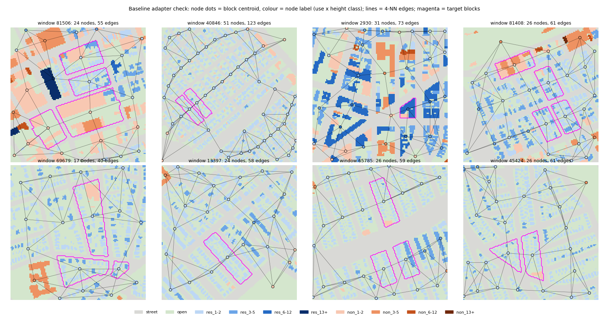

- Dots sit at block centers and their color matches the buildings in the block (e.g. the dark-blue tall block in the first tile); edges connect nearby blocks; magenta outlines are the target blocks. ✅
- Blocks per tile: median 26 (min 12, max 56); edges per tile: median 61.
- Node classes: residential 1–2 floors is the most common (56%); residential and non-residential 13+ are each about 1%.

**Fixed test subset**: `~/genai-final/data/city/test_subset.json`, the 19,380 test samples shuffled with a fixed seed. Every model uses the first n (the midway uses the first 200, with 77/50/47/26 samples of 1/2/3/4 target blocks). **Daehong's evaluation should use the same list.**

**Graph check (Nov 18, after James noticed odd patterns in the check figure)**

500 training tiles, 12,968 nodes:

| What we saw | Cause | Share | Action |
|---|---|---|---|
| Many dots crowded on the tile edge | The block is only partly inside the 512 m tile, and the dot is the center of the visible part | 57.5% of nodes are cut; 6.2% show fewer than 20 cells (about 320 m²) | **Fixed (Nov 18)**: blocks with fewer than 20 visible cells are dropped. Target blocks are always kept (samples keep at least 48 m of context around them, so they are always fully inside) |
| Long edges crossing other blocks | kNN uses straight-line distance between centers and ignores whether blocks face each other across a street. Near the tile edge or next to parks, the 4 nearest can be far away | 4.3% of edges are longer than 200 m (median 118 m) | Kept. **This is a known weakness of the baseline**; change 1 switches to street-facing edges |
| Some dots have more than 4 edges | If A picks B among its 4 nearest but B does not pick A, the edge is still added (both directions) | mean 4.7, max 9 | Expected |
| A chain of dots along an arc (tile 40846) | Brooklyn tax block 3-08914 is split by small streets into pieces a–h, each a narrow block with a row of 10–17 houses | — | Expected, these are real blocks |
| Dots outside their block | The center of an L- or U-shaped block falls outside it | 0.7% | Kept |

**After dropping edge slivers** (same 500 tiles):

| | Before | After |
|---|---|---|
| Nodes per tile | 25.9 | **24.3** |
| Nodes with fewer than 20 visible cells | 6.2% | **0** |
| Target blocks dropped by mistake | — | **none (1122 / 1122 kept)** |
| Edges longer than 200 m | 4.3% | 5.1% (with fewer edge dots, the 4 nearest are slightly farther) |

New check figure: [progress/step1_adapter_check_filter20.png](progress/step1_adapter_check_filter20.png) (the same 8 tiles, each with 1–2 fewer edge dots).

**Diagnostic mode**: with `use_gt_positions: true`, generation uses the true block centers and skips localization. Comparing it with normal generation separates errors from misplaced blocks and errors from what is drawn.

### Step 2: test run and speed (done Nov 17)

50 real training steps on real data (`tools/nyc_bench.py`):

| Item | Result |
|---|---|
| Time per step (batch 16) | **0.226 s** |
| One epoch of training data | **13.1 min** |
| Share of time waiting for data | 1% (4 CPUs are enough) |
| Peak GPU memory | **5.2 GB** / 23 GB |
| Loss | 17.9 → 7.4, decreasing, no NaN ✅ |
| Generating one map (100 steps) | 0.47 s |

**Decision**: keep Liu's batch size of 16. Memory allows more, but changing it would change Liu's training settings and the baseline would no longer be the original.

### Step 3: overfit 8 tiles (done Nov 17, ✅ passed)

**Procedure** (`scripts/run_overfit.sh`, log AWS `~/genai-final/logs/step3_overfit.log`):
1. Train on 8 training tiles for 80 epochs (4,000 steps, about 9 minutes)
2. Post-train localization for 40 epochs (about 2 minutes)
3. Generate the same 8 tiles, 4 samples each, with true centers and with the model's predicted centers

**Loss**

| | Epoch 1 | Epoch 40 | Epoch 80 |
|---|---|---|---|
| diffusion | 5.51 | 0.15 | **0.03** |
| localization | 7.37 | 0.04 | — |

**Results inside the mask**

| Metric | True centers | Predicted centers |
|---|---|---|
| Cell accuracy | **100%** | **92.7%** |
| Building / not accuracy | 100% | 96.4% |
| Building coverage error | 0.000 | 0.016 |
| Dominant height class accuracy | 100% | 89% |
| Difference between the 4 samples | 0% | 14% |

**Conclusion**: with true centers the model reproduces all 8 tiles **exactly**, so the whole path data → graph → model → sampling → saving is wired correctly. With predicted centers it sometimes moves a whole block elsewhere, so the 4 samples differ. This is the original Liu behavior: sampling draws positions with Gumbel noise (tau = 2).

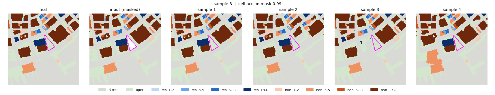
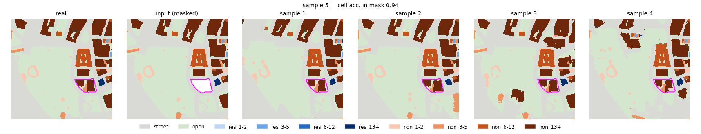

> Panels: real map | masked (white is the masked area) | 4 generated samples. Magenta outlines are the target blocks. These 8 tiles happen to be in Lower Manhattan.

### Step 4: full training (done Nov 18)

**Result (run 3)**: Nov 18, 03:55–15:55 UTC, the full 12 hours, **55 epochs**.
- Diffusion loss: 6.0 in epoch 1 → 4.6 in epoch 5 → 4.25 in epoch 40 → 4.20 in epoch 55. Almost flat after epoch 40, i.e. converged.
- That is about 0.26 nats per cell; random guessing is 2.30, so about 1/9 of it (the loss is summed over the 16 maps of a batch and divided by the number of cells, see `models/diffusion.py:160`).
- Gradient norm stayed around 1.1 with no spikes; every 30-minute health check was OK.
- Localization: finished 16:55 UTC after 37 epochs. Loss 8.76 → 7.07, still decreasing at the end, so **the 1-hour budget was not enough** (random guessing is ln(16384) = 9.70).
- Checkpoints: `checkpoints/nyc_baseline/epoch50.tar`, `epoch55.tar`, `latest.tar`; `checkpoints/nyc_baseline_loc/latest.tar`.

**Training runs**

`scripts/run_baseline.sh` runs, in order:

| Stage | Contents | Time | Output (AWS) |
|---|---|---|---|
| 4a | Main training on all 55,813 training tiles | 12 h budget, about 55 epochs | `checkpoints/nyc_baseline/` |
| 4b | Localization post-training | 1 h budget | `checkpoints/nyc_baseline_loc/` |
| 5 | First 200 samples of the fixed test subset, 4 samples each, with predicted and with true centers | about 15 min | `generated/nyc_baseline_test200*/` |
| 5 | Quick metrics | 1 min | `generated/nyc_baseline_test200_metrics.txt` |

- A checkpoint every 5 epochs; only the newest 2 plus `latest.tar` are kept, about 2 GB.
- **If the run stops**: `ssh a4-gpu`, then `tmux new -s train "RESUME=1 bash ~/genai-final/control-3d-scene/scripts/run_baseline.sh 2>&1 | tee -a ~/genai-final/logs/step4_baseline.log"` resumes from the last checkpoint. Note that the time budget restarts from zero.

**Run 1 (Nov 18, 03:21–03:38 UTC, stopped)**: Liu's original settings (learning rate 0.004, no gradient clipping). Epoch 1 was normal and diffusion fell to about 5.1, but at steps 600–700 of epoch 2 it jumped to about 15.8 and was still 7.5 at step 1,200. Log kept: `logs/step4_baseline_run1_lr004_noclip.log`.

**Run 2 (Nov 18, 03:43–03:53 UTC, stopped)**: stopped to drop edge slivers, before any checkpoint; log in `logs/step4_baseline_run2_clip_nofilter.log`. One setting changed: `clip_norm: 1.0` (gradient clipping, which limits how far one step can move the weights). Learning rate and all other settings are as in Liu. The training log was also changed:
- Each line shows **the mean of the last 100 steps** instead of the running mean of the epoch, so spikes are visible
- A `grad_norm` column (gradient norm before clipping); a sudden jump means unstable training

At the start: diffusion 13.0 → 7.7 (first 300 steps), grad_norm 18 → 5.8.

**Run 3 (from Nov 18, 03:55 UTC, the final run)**: same as run 2 plus `min_visible_cells: 20` to drop edge slivers (#10). At the start: diffusion 13.2 → 8.9, grad_norm 16.9 → 7.0 (first 200 steps).

**What each number in the log means**

```
epoch 2/1000 iter 600/3488 | total: …, diffusion: …, recon: …, seg: …, grad_norm: … | 0.26 h
```

| Field | Meaning | How to read it |
|---|---|---|
| `epoch` | Epoch number (one epoch = all 55,813 tiles once). 1000 is only an upper limit; training stops at 12 h | |
| `iter` | Step within the epoch (16 tiles per step, 3,488 steps per epoch) | |
| `total` | Total loss = 0.6 × diffusion + 0.2 × recon + 0.2 × seg | lower is better |
| `diffusion` | How well the model recovers the real map from a noised one | **most important**, should keep falling |
| `recon` | Whether the GNN can tell which blocks are connected (random ≈ 1.39) | staying near 0.9 is normal |
| `seg` | Whether the GNN keeps each block's class (random over 10 classes ≈ 2.3) | falls quickly to near 0 |
| `grad_norm` | Size of the update before clipping | a sudden jump = unstable |
| `0.26 h` | Training time so far | stops at 12 h |

### Step 5: test generation and scores (done Nov 18)

First 200 samples of the fixed test subset (`test_subset.json`), 4 samples each, **scored only inside the target blocks**; brackets are 95% confidence intervals. Two settings:
- **Predicted centers**: the official baseline; the model predicts each block's position.
- **True centers**: diagnostic; the model is given each block's true center, which separates localization errors from drawing errors.

| Metric | Meaning | Predicted centers (official) | True centers (diagnostic) |
|---|---|---|---|
| cell_acc | Share of cells with the exact class (10 classes) | **0.317** [0.301, 0.333] | 0.417 [0.402, 0.432] |
| bldg_acc | Building / not building correct | 0.554 [0.539, 0.568] | 0.594 [0.584, 0.603] |
| cov_err | Building coverage error (lower is better) | 0.278 [0.262, 0.296] | 0.118 [0.107, 0.130] |
| hclass_acc | Dominant height class correct | 0.760 [0.715, 0.804] | 0.861 [0.824, 0.897] |
| use_acc | Dominant use (residential / not) correct | 0.782 [0.739, 0.825] | 0.863 [0.821, 0.901] |
| diversity | Share of cells that differ between the 4 samples of one input | 0.610 | 0.536 |
| street_in_mask | Share of target cells drawn as street (real: 0) | **0.350** | 0.107 |

Full output: `progress/step5_baseline/nyc_baseline_test200_metrics.txt`. Figures of the first 24 samples: `progress/step5_baseline/pred_pos/` (predicted centers) and `progress/step5_baseline/gt_pos/` (true centers); the same file name in both folders shows the same sample.

#### Figure 1: training curves

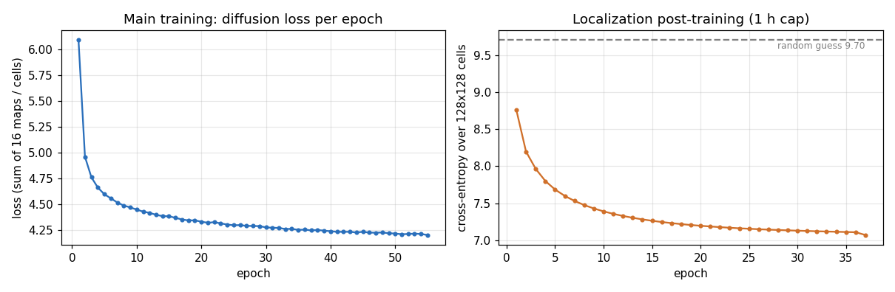

- **Left (main model)**: the biggest drop is from epoch 1 to 2, then a slow decline that is almost flat after epoch 40; more training would help little at this setting.
- **Right (localization)**: the dashed line is random guessing (9.70). The loss reaches 7.07 and **is still falling at the end**; the 1-hour budget cut it off. This is why localization is the weakest part.

#### Figure 2: score comparison

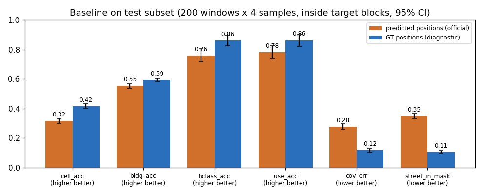

Orange is the official result (predicted centers), blue the diagnostic (true centers), black bars are 95% confidence intervals. **The gap between orange and blue is the cost of localization errors.** It is largest in the two rightmost groups: coverage error 0.28 vs 0.12, and street in the mask 0.35 vs 0.11.

#### Figure 3: generated examples

Each figure, left to right: **real map | input (white = masked target blocks, magenta outline) | 4 generated samples**. The title's `cell acc.` is the mean cell accuracy of the 4 samples inside the outline. Colors: gray = street, light green = open, blues = residential (darker = taller), oranges = non-residential (darker = taller).

> Note: the baseline does not see the surrounding map and **draws the whole tile itself**, so differences outside the magenta outline are expected. Look inside the outline and at the overall street direction and grid.

**Example 1: `43146`, Queens row houses (2 target blocks, both labeled residential 3–5 floors), the clearest case of the localization problem**

Predicted centers (official): accuracy inside the outline 0.25

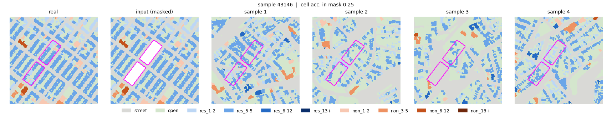

True centers (diagnostic): accuracy inside the outline 0.50

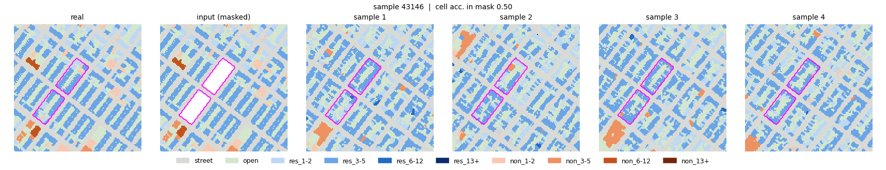

- Top: misplaced blocks turn the streets into large gray areas and curved roads; in some samples the outline is almost all street (sample 3).
- Bottom: the same model with true centers immediately draws the diagonal street grid and rows of 3–5 floor row houses (mid blue), very close to the real map. **The model can draw; it fails on position.**

**Example 2: `16148`, low-density Queens (target block labeled non-residential 1–2 floors), the same problem**

Predicted centers: 0.22 inside the outline

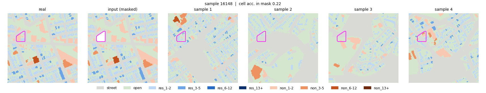

True centers: 0.31 inside the outline

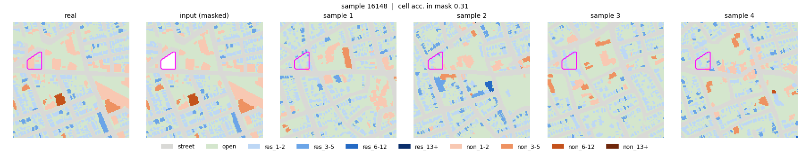

- Samples 1–3 on top show a large gray area in the middle, the hole left by misplaced blocks.
- The bottom streets look normal, but the non-residential buildings (light orange) inside the real outline are not drawn; most samples leave it open. This is an example of **one label not describing a block** (D7).

**Example 3: `59415` (Brooklyn) and `79698` (Queens), the best case with true centers (regular 1–2 floor residential)**

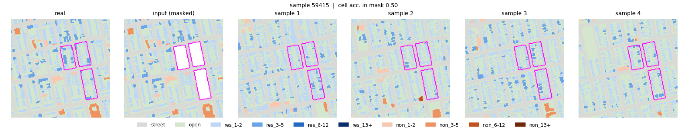

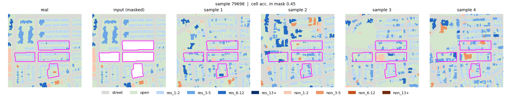

- Street direction, block size and the density of 1–2 floor houses (light blue) are right; accuracy inside the outline is 0.45–0.50.
- The 4 samples arrange buildings differently but plausibly, so the model is **diverse** rather than memorizing.
- In `79698`, samples 2 and 4 put non-residential buildings (orange) inside the outline, an example of a wrong use class.

**Example 4: `5626` (Bronx) and `9498` (Brooklyn), common failures**

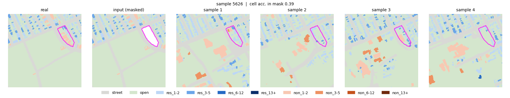

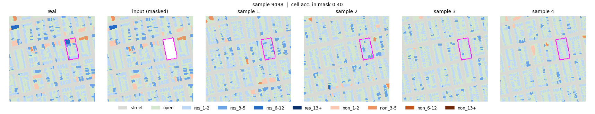

- `5626`: the lower half of the real map is a large park (light green), but the model scatters buildings over it. The park is one node in the graph with a class and a center but no size, so **the model does not know block size or shape**. Change 2 (polygon allocation) addresses this.
- `9498`: too few buildings inside the outline; samples 3 and 4 are almost empty. The real block has a 6–12 floor building (dark blue) in its upper left that none of the 4 samples draws. The single label (residential 1–2 floors) hides the few tall buildings (D7); the numeric attributes of change 1 should help.

**Conclusions from the figures and scores**
1. **Localization is the weakest part.** Misplaced blocks shift the streets of the whole tile, often leaving large gray areas or curved roads (`43146.png`, `16148.png`). 35% of the masked area becomes street, and coverage error is 2.4× that with true centers.
2. **With true centers the drawing is reasonable.** Street direction, block grid and row houses are right (clear in `gt_pos/43146.png`). Dominant height class and use are about 86% correct.
3. **Exact detail cannot match.** The baseline only knows each block's class and approximate position, not the real building shapes, so exact cell accuracy is low (0.42). This is expected and is what changes 1–3 target.
4. **The baseline does not see the surroundings.** It generates the whole 512 m tile, inventing the context, so it does not join the real surroundings. Change 3 (context input) addresses this.
5. **Numbers for tall blocks are unreliable** (D3): only 4 target blocks of 13+ floors in the first 200 samples.

**Possible improvements (without making the baseline unfair)**
- Localization trained for only 1 hour and was still improving. It could train longer, but every model must get the same time; decide with the team before changes 1–3.
- The midway report shows both results: predicted centers as the official baseline, true centers to show where the bottleneck is.

### Step 6: evaluation code (done Nov 19, on the laptop)

Code in `evaluation/`; definitions and references of every metric in `evaluation/README.md`. All models share it; the input is one `.npz` per test window (`gen`, `gt`, `mask`), the format the baseline already writes.

| Group | Metrics |
|---|---|
| Condition | Cov. err., FAR err. (plus median relative error), Height acc. (area-weighted median, empty blocks excluded), Res. err. (floor-area residential share), hit rate; use accuracy in the text only |
| Surroundings | Boundary (WD of height difference to facing blocks), Street wall (WD of street wall ratio), street wall vs neighbour |
| Realism | CNN two-sample test on the block alone (`c2st.py`, conda env `genai`), Footprint (WD of four region measures) |
| Diversity | pairwise cell disagreement of the 4 samples |
| Statistics | block-cluster bootstrap, paired model comparison (`--compare`) |

**Checks**: all 16 checks of `tests/test_metrics.py` pass (the real map gives 0 / 1; raised heights, removed buildings and shuffled cells move each metric the right way). CNN test: real vs real 0.50, real vs shuffled 0.88.

**Oracle row (real map, first 1,000 test windows, 1,817 target blocks, `evaluation/results/oracle/`)**

| Metric | Value [95% CI] |
|---|---|
| FAR err. | 0.131 [0.116, 0.148] (median relative error 9.2%) |
| Cov. err. | 0.012 [0.011, 0.013] |
| Height acc. | 0.996 |
| Res. err. | 0.070 [0.067, 0.074] (use accuracy 96.9%) |
| Hit rate | **0.56** (even the real map, see below) |
| Boundary, Street wall, Footprint | 0 |
| CNN acc. | 0.50 |

**Findings**
- **The FAR floor is 0.13, not the 0.22 of the data audit**: 0.22 averaged all valid blocks, while the first 1,000 test windows are more low-rise. The oracle row of the midway Table 2 should use the measured values.
- **A ±10% hit rate is strict for FAR**: even the real map meets it for only 56% of blocks because four height classes are coarse. **Decision (Nov 19): keep ±10% and read it against the oracle's 56%.**
- The oracle row of midway Table 2 now uses the measured values (0.13 / 0.01 / 1.00 / 0.07 / 0 / 0 / 50% / 0), pushed to Overleaf.
- Fitted floors per height class: 1.53 / 3.42 / 7.13 / 25.08.

### Step 7: final evaluation of the baseline on 1,000 test windows (done Nov 20)

On AWS, the existing checkpoints generated the first 1,000 test windows × 4 samples (predicted and true centers, about 31 min each), followed by the evaluation and CNN test (about 17 min). Script `control-3d-scene/scripts/run_eval1000.sh`, log `progress/step7_eval1000.log`, results `evaluation/results/nyc_baseline_test1000*/`. **The instance was stopped afterwards.**

| Metric | Liu (predicted centers) | Liu + true centers | Oracle (real map) |
|---|---|---|---|
| FAR err. ↓ | 0.733 [0.697, 0.775] | 0.427 [0.401, 0.458] | 0.131 |
| FAR median relative error ↓ | 68.5% | 32.1% | 9.2% |
| Cov. err. ↓ | 0.273 | 0.123 | 0.012 |
| Height acc. ↑ | 0.725 | 0.845 | 0.996 |
| Res. err. ↓ | 0.245 | 0.186 | 0.070 |
| Use accuracy (text only) | 79.8% | 89.2% | 96.9% |
| Hit rate ↑ | **2.8%** | 10.7% | 56.0% |
| Boundary ↓ | 0.210 | 0.133 | 0 |
| Street wall ↓ | 0.106 | 0.073 | 0 |
| Street wall vs neighbour ↓ | 0.057 | 0.070 | 0 |
| Footprint ↓ | 0.223 | 0.159 | 0 |
| Diversity | 0.596 | 0.529 | — |
| CNN acc. (→ 50%) | **96.4%** (90.9–98.4%) | 86.9% (74.8–98.5%) | 50% |

**Paired comparison** (true − predicted centers, same 1,817 blocks): FAR error −0.31, coverage error −0.15, height accuracy +0.12, residential-share error −0.06, hit rate +0.08; **all intervals exclude 0**.

**Reading**
- **Targets are almost never met**: only 2.8% of blocks meet FAR and coverage within ±10% with predicted centers, 10.7% with true centers (56% for the real map). The baseline knows classes but not numbers, which change 1 addresses.
- **Localization is the largest single problem**: every condition metric improves significantly with true centers.
- **Generated blocks are easy to spot**: the CNN separates them 96% of the time (87% with true centers). The CNN varies a lot across the 5 splits (75–98%); more windows or repeats should stabilise it.
- Street wall vs neighbour is slightly worse with true centers (0.070 vs 0.057); a small gap, to be revisited with change 3.

The two Liu rows of midway Table 2 are filled and the Baseline results paragraph has a summary sentence, pushed to Overleaf (the text now fills exactly four pages).

---

## Data audit (Nov 18)

Script: `tools/nyc_data_audit.py`. Full output on AWS in `~/genai-final/logs/data_audit.txt`. Ordered by impact on the project:

| # | Finding | Numbers | Impact | Suggestion | Owner |
|---|---|---|---|---|---|
| D1 | **The 10-class map cannot give exact FAR**: only 4 height classes, so 6 and 12 floors look the same | Even the **real map** gives a median FAR error of 13% (MAE 0.29); MAE 3.6 for 13+ blocks | Generated FAR error has a floor that no model can go below; without knowing it, the model looks worse than it is | Add a "real map" row to the evaluation table. Fit floors per height class on training data (result: 1.5 / 3.4 / 7 / 24 floors) | Daehong (evaluation) |
| D2 | **Test tiles overlap heavily** | Each location is covered by about 28 tiles; the 19,380 test tiles equal about 700 non-overlapping tiles | A bootstrap over tiles gives intervals that are **too narrow** | Bootstrap clustered by block (only 10 test districts, too few to cluster by district). **Impact (Nov 18): small.** The first 200 samples have 415 distinct target blocks out of 422, and only 22 pairs of tiles overlap by more than half; the first 1,500 have 2,520 distinct out of 3,213. Overlap in training acts as random cropping. All models use the same samples, so rankings are unaffected | Daehong (evaluation) |
| D3 | **Almost no tall buildings in the test set** | Only **4** target blocks of 13+ floors and 26 of 6–12 floors in the first 200 samples; 168 (0.4%) of 13+ in the whole test set | Height class accuracy on tall blocks is meaningless with 4 samples | Build a separate tall-block test subset and report it apart, or redo the split | Team |
| D4 | **The 4 m grid merges adjacent buildings** | 33 buildings per block become 11 connected regions on the map; 3–5 floor row houses merge 4 to 1 on average; in 23% of blocks 5 or more buildings merge into one region | Building size and spacing measures count regions, not buildings, so they cannot be compared directly with GlobalMapper's numbers computed on real footprints | Use the **same grid method** for real and generated maps; call them "building regions" in the report. **Impact (Nov 18): small.** Of the proposal's metrics, only building size / spacing distributions are affected; condition error, Out-Block, boundary continuity, the CNN real/fake test and diversity are per cell and unaffected. Comparison between models stays fair | Daehong, Chenyue |
| D5 | **No overfitting check during training** | 55 epochs × about 29 tiles per location, so each place is seen over a thousand times | Liu's code has no validation loss during training | Compute validation loss of each checkpoint after training and pick the best (can be added to Step 5) | James |
| D6 | **FAR in Queens and Staten Island is about 25% above PLUTO** | Median far_fp / PLUTO: QN 1.23, SI 1.26, about 1.0 elsewhere; 40% of QN and SI blocks differ by more than 30% | No effect on the generator, which learns far_fp consistent with the map. For the language step, a user's "FAR 1.0" in the official sense would be off by over 20% in these boroughs | Daehong to check the cause (pitched roofs counted as an extra floor, garages included); or state in the report that FAR is computed from footprints | Daehong |
| D7 | **One class label does not describe a block** | Only 68% of building cells in a block match its label; in 17% of blocks fewer than half do; 14% of cells are taller than the label | A built-in limit of the baseline, and **concrete motivation for change 1** | Use as motivation in the report | — |
| D8 | **5.5% of context blocks failed the validity checks** | Causes include FAR disagreeing with PLUTO, water, construction, too large or too small | Small for the baseline. In change 1 these blocks would carry **possibly wrong numbers** as context | In change 1, add an "unreliable" flag or mask their numbers | James (change 1) |
| D9 | **Water is drawn as street** | 6% of training tiles are more than 10% water; 4% of "street" cells are water | Small, but metrics such as "buildings on streets" should exclude water | Exclude water with `water.npy` in evaluation | Daehong |
| D10 | **No Staten Island in the validation set** | Staten Island has only 3 districts; one went to test, none left for validation | Staten Island is not represented when tuning on validation | Discuss together with a re-split | Team |

Two other known points:
- Daehong's `dataset.py` maps the empty-block height class -1 to 0 (same as 1–2 floors). Change 1 must handle this when using `node_attr`; our adapter already handles it separately.
- Validation is denser and test sparser (see open decisions).

---

## Problems

| # | Problem | Status | Handling |
|---|---|---|---|
| 1 | Only 23 GB free disk on AWS | ✅ Solved | Deleted an old course folder (42 GB); **58 GB** free after environment and data |
| 2 | Laptop GPU has only 6 GB, not enough for training | ✅ Solved | Use the AWS A10G |
| 3 | AWS has only 4 CPUs | ⚠️ Note | Data workers reduced from Liu's 8 to 3; measured in Step 2, not a bottleneck |
| 4 | Each checkpoint is about 0.7 GB | ⚠️ Note | Liu saves every 100 epochs; we keep only the newest few to save disk |
| 5 | The AWS IP changes after a stop/start | ⚠️ Note | Update `HostName` of `a4-gpu` in the laptop's `~/.ssh/config` |
| 6 | The instance is billed while running | ⚠️ Note | About $1 per hour; stop it in the AWS console when not in use |
| 7 | Water is labeled "street" (class 0) on the map | ⚠️ Data | No effect on the baseline (water is never masked), but street statistics include water. Discuss with Daehong whether to add a class |
| 8 | Liu's position code quirk: the top-left cell uses slot 0 and slot 1 is never used | ℹ️ Kept | Liu's original code; the baseline stays faithful to it |
| 9 | Liu's learning rate 0.004 made the loss spike in epoch 2 (diffusion from about 5 to about 16) | ✅ Handled | Gradient clipping `clip_norm: 1.0` (an existing option in Liu's code, off by default), retrained. **All three changes use the same setting** for a fair comparison; the report states that this is the only training setting that differs from Liu |
| 10 | The graph in the check figure looked odd (dots on the tile edge, long edges across blocks, an arc of dots) | ✅ Checked, not a bug; edge slivers dropped | Statistics on 500 tiles, see "Graph check" under Step 1. Blocks cut by the tile edge down to a small corner carry the whole block's class (and, in change 1, the whole block's FAR), which is misleading, so **blocks with fewer than 20 visible cells (320 m²) are dropped** (`min_visible_cells: 20`) and training was restarted (run 3). **All three changes use this setting too** |

---

## Open decisions and to-do

### Team decisions

- [ ] **Baseline edges**: each block connects to its 4 nearest blocks (agreed by James). Street-facing edges are part of change 1 and cannot be used in the baseline. Waiting for team confirmation.
- [ ] **Re-split the data?** (ask Daehong): validation drew many tall districts (median FAR 1.57) while test is almost all low-rise (only 0.4% 13+), so scores across splits are not comparable.
- [ ] **Size of the final test set** (ask Daehong): all 19,380 samples × 4 take about 11 hours per model, 55 hours for 5 models. Suggest a fixed 1,000–2,000 samples, also used by the evaluation code.
- [ ] **Output format for evaluation** (ask Daehong): how generated results should be saved so his code can read them directly.
- [ ] **Finer height classes? (D1)**: 4 classes limit how exactly FAR can be controlled. A change must be decided **before change 1 starts on Nov 21**, since the baseline would be retrained on the new map. Suggestion: keep 4 classes and report the real-map error floor.
- [ ] **The 4 `[TEAM DECISION]`s**: mixed use, garages and buildings under construction, whether to exclude FAR mismatches, split fractions.
- [ ] **Update the proposal numbers**: block counts and correlations should use the full-city values; confirm how the link rate of 1.000 is computed.

### Next (Steps 4–5)

- [x] No spike at step 600 of epoch 2 (where run 1 spiked): in run 3, diffusion stayed at 4.9–5.1 and grad_norm at 1.0–1.4 over steps 500–1,600 of epoch 2 ✅
- [x] First checkpoint OK (Nov 18, 05:00 UTC, epoch 5): 0.69 GB per checkpoint, 56 GB free; about 13 minutes per epoch as estimated. Diffusion over the first 5 epochs: 6.0 → 4.6 ✅
- [x] Full training finished (Nov 18, 15:55 UTC, 55 epochs) ✅
- [x] Localization, generation and scoring finished (17:08 UTC); scores and figures copied to the laptop ✅
- [x] Midway draft: `latex/midway.tex` (the proposal `main.tex` is unchanged). New figure `latex/fig/baseline_samples.pdf` (43146, 59415, 5626, both settings) and a spare `latex/fig/baseline_metrics.pdf`. Red TODOs are for Daehong and Chenyue; compile on Overleaf to check the 4-page limit ✅ (Nov 18)
- [ ] (Optional) Validation loss to confirm no memorization (D5), a few minutes
- [ ] Decide with the team how long localization trains for every model (currently 1 hour, not converged)
- [ ] Fix checkpoint name sorting in `nyc_watch.py` (shows epoch5 instead of the newest; display only)
- [ ] **The instance is idle; stop it when not in use** (54 GB free)

---

## Compute (A10G)

> Measured in Step 2; the estimates and measurements are close.

| Item | Estimate | Measured |
|---|---|---|
| Environment setup | 20–30 min | **about 10 min** |
| Data upload (873 MB) | a few minutes | **2 min** |
| One training step (batch 16) | 0.2–0.3 s | **0.226 s** |
| One epoch (55,813 tiles) | about 13 min (8–25 min) | **13.1 min** |
| Full training | 12 h, about 50 epochs | 12 h ≈ **55 epochs** |
| Localization post-training | 30 min – 1 h | **1 h (budget), 37 epochs, not fully converged** |
| One generated map (100 steps) | about 0.5 s | **0.47 s** |
| 200 samples × 4 | about 10 min | **6.3 min** (per setting) |
| Whole baseline pipeline | about 13.5 h | **13 h 13 min** (03:55–17:08 UTC) |

**GPU time for the whole project**: about 75–80 hours (4 models × 12 h of training + test generation + debugging margin), about $80.
